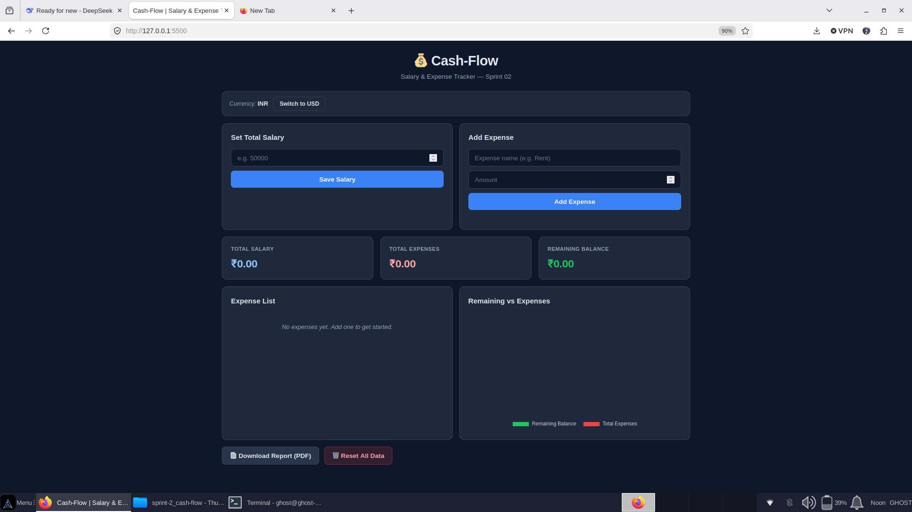
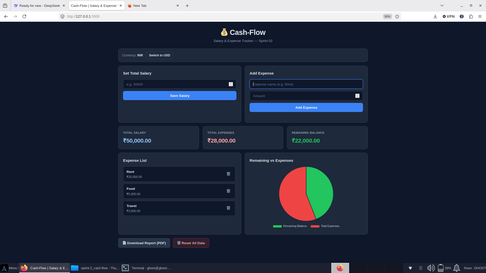
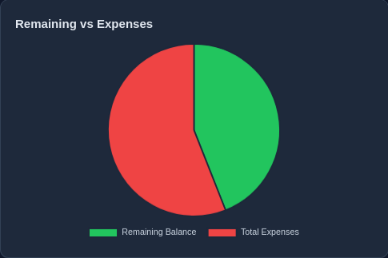
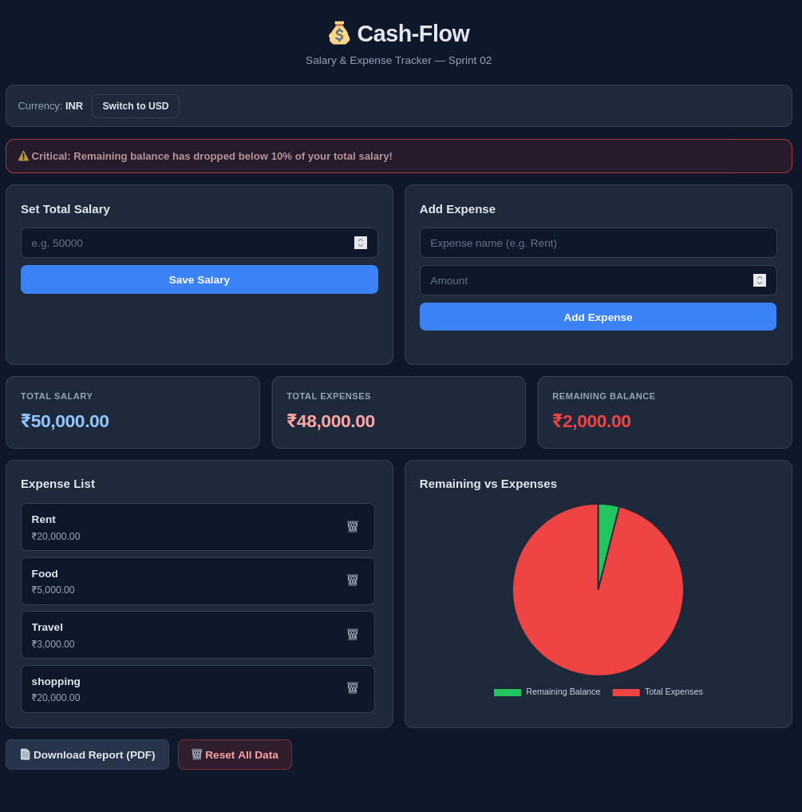
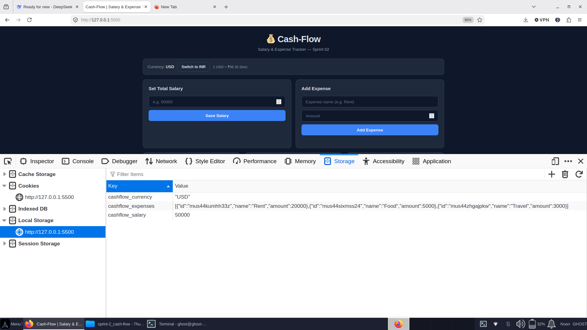
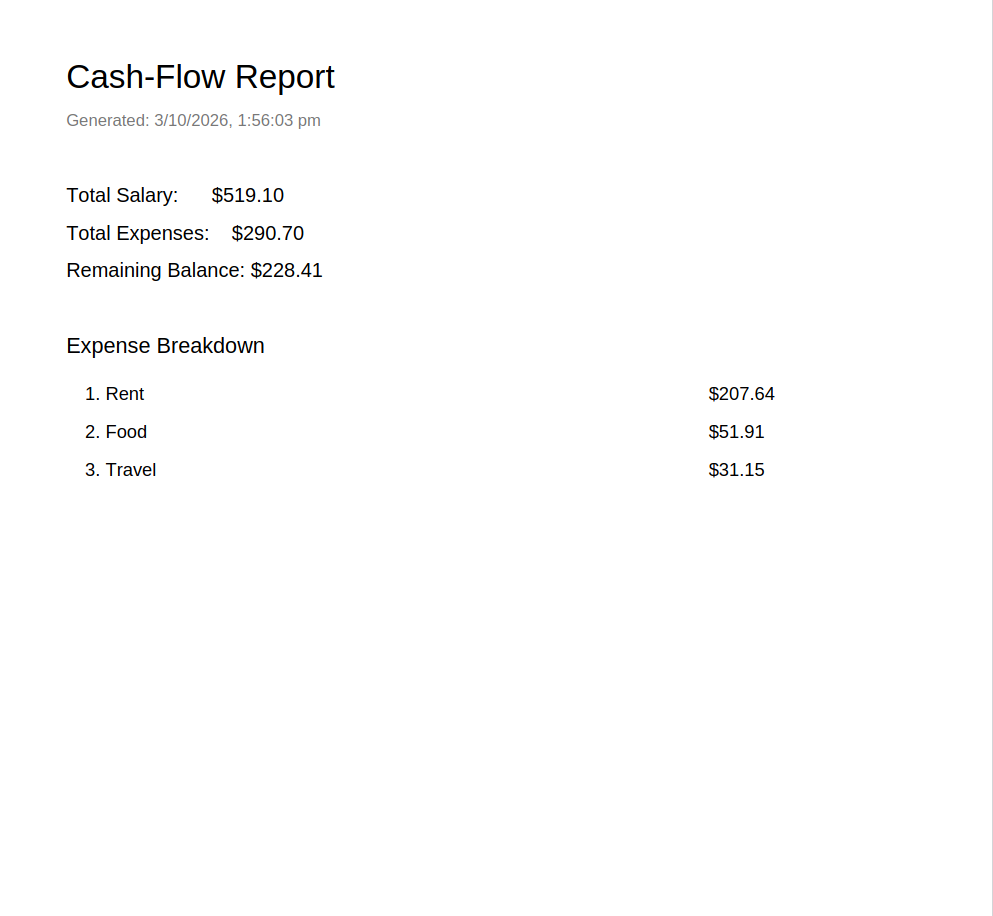
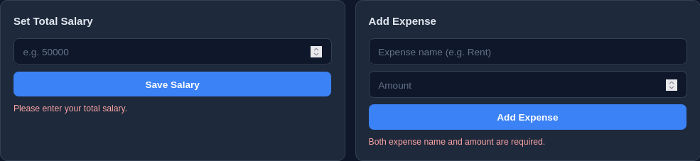

# 💰 Cash-Flow — Salary & Expense Tracker

> **Sprint 02 Deliverable** — Logic & Data Phase
> Vanilla JavaScript · No Frameworks · Pure DOM Manipulation

[](https://y-ro9.github.io/cash-flow/)
[](https://github.com/y-ro9/cash-flow)
[]()
[]()

---

A functional finance dashboard where users can set their salary, log expenses, view real-time balance updates, and persist state across browser reloads. Built as the Sprint 02 milestone — mastering DOM Manipulation, Event Listeners, and Data Persistence before moving to React abstraction in Sprint 05.

---

## 🎯 Project Overview

| Attribute | Detail |
|-----------|--------|
| **Sprint** | 02 — Logic & Data |
| **Objective** | Build a stateful dashboard with real-time updates |
| **Stack** | Vanilla JS (ES6+), HTML5, CSS3 |
| **Constraint** | ❌ No React, ❌ No Vue — strict vanilla only |
| **Deadline** | 6 days from assignment |
| **Status** | ✅ Phase 1 + Phase 2 + Phase 3 (all stretch goals) complete |

---

## ✨ Features

### Phase 1 — Base MVP (P0) ✅
- 📝 Input form for **Total Salary**, **Expense Name**, **Expense Amount**
- 🔢 Real-time rendering of salary and expenses to DOM
- 🧮 Live calculation: `Remaining Balance = Salary − Total Expenses`
- ⚠️ Input validation — blocks empty and negative values with inline error states

### Phase 2 — Persistence & Visualization (P1) ✅
- 💾 **LocalStorage integration** — salary, expenses, and currency persist across reloads
- 🗑️ **Delete operations** — removes from DOM + LocalStorage + recalculates instantly
- 📊 **Chart.js Pie Chart** — dynamic visualization of Remaining Balance vs Total Expenses
- 🔄 Chart instance properly `.destroy()`-ed before re-render to prevent duplication

### Phase 3 — Stretch Goals (P2) ✅
- 📄 **PDF Report Export** via jsPDF — full breakdown of salary, expenses, and balance
- 💱 **Live Currency Conversion** — INR ↔ USD toggle via Frankfurter API
- 🚨 **Threshold Alerts** — balance < 10% of salary triggers RED text + pulsing banner

---

## 📸 Screenshots

### 🏠 Main Dashboard — Empty State

*Clean dark-mode UI with all input forms, summary stats, and chart placeholder.*

### 💵 Salary & Expenses Loaded

*Real-time rendering after adding salary and multiple expense entries.*

### 📊 Pie Chart Visualization

*Dynamic Chart.js pie chart showing Remaining Balance vs Total Expenses.*

### 🚨 Threshold Alert Active

*Critical UI warning triggered when remaining balance drops below 10% of salary.*

### 💱 Currency Conversion (USD)

*Live INR → USD conversion via Frankfurter API — rate cached in memory.*

### 💾 LocalStorage Persistence

*DevTools Application tab showing persisted `cashflow_salary` and `cashflow_expenses` keys.*

### 📄 PDF Report Export

*Generated PDF report with summary and full expense breakdown via jsPDF.*

### ✅ Validation Error State

*Inline error handling for empty / invalid inputs.*

---

## 🚀 Getting Started

### Prerequisites
- A modern browser (Chrome / Firefox / Brave)
- Python 3 (for local server) **OR** Node.js

### Installation

```bash
# Clone the repository
git clone https://github.com/<your-username>/cash-flow.git
cd cash-flow

# Start a local server (LocalStorage + fetch require http://, not file://)
python3 -m http.server 5500
```

Open **http://localhost:5500** in your browser.

> ⚠️ **Do NOT** open `index.html` directly via `file://` — LocalStorage and the currency API will be blocked by CORS.

---

## 📁 Project Structure

```
cash-flow/
├── index.html          # Markup + CDN scripts
├── style.css           # Vanilla CSS (dark theme, responsive)
├── script.js           # All application logic
├── Prompts.md          # Engineering decision log
├── README.md           # You are here
└── screenshots/        # UI screenshots for documentation
```

---

## 🧠 Engineering Decisions

| Decision | Rationale |
|----------|-----------|
| **Vanilla CSS over Tailwind** | Sprint FAQ #9 states grading is on JS logic. Fewer CDN dependencies = fewer failure points during QA. |
| **Internal storage always in INR** | Currency toggle only affects *display* + *input interpretation*. Prevents rounding drift when toggling back and forth. |
| **`Number()` parsing on all inputs** | FAQ #1 — DOM inputs return strings by default (`"10" + "10" = "1010"`). |
| **`JSON.stringify` / `JSON.parse`** | FAQ #2 — LocalStorage only accepts string payloads. |
| **`.destroy()` before chart re-render** | FAQ #8 — prevents duplicate/stacked chart instances. |
| **Graceful API degradation** | If Frankfurter fetch fails, app stays on INR instead of crashing. |

---

## 🔬 QA Verification Points

The 2-minute demo video must explicitly demonstrate:

- ✅ **Mathematical logic** — `Salary − Σ(Expenses) = Remaining Balance`
- ✅ **LocalStorage persistence** — DevTools → Application → Local Storage → reload → data survives
- ✅ **Validation** — empty/negative inputs produce inline errors
- ✅ **Chart re-render** — no duplicate charts on adding new expenses
- ✅ **Delete sync** — DOM, LocalStorage, and balance all update together
- ✅ **Currency toggle** — live API fetch with visible rate display
- ✅ **PDF export** — generated report opens with correct data

---

## 📚 References

- [MDN — JavaScript DOM Manipulation](https://developer.mozilla.org/en-US/docs/Web/API/Document_Object_Model)
- [MDN — LocalStorage API](https://developer.mozilla.org/en-US/docs/Web/API/Window/localStorage)
- [Chart.js Documentation](https://www.chartjs.org/docs/latest/)
- [jsPDF Documentation](https://github.com/parallax/jsPDF)
- [Frankfurter API](https://www.frankfurter.app/docs/)

---

## 🛣️ Roadmap (Future Sprints)

- **Sprint 05** — Port to React (component abstraction, hooks-based state)
- **Sprint 06+** — Backend integration (Node/Express), user authentication, cloud sync

---

## 👤 Author

**Yash Raj**
Sprint 02 Associate
GitHub: [@y-ro9](https://github.com/y-ro9)

---

## 📄 License

This project is part of an internal engineering sprint. Not for public distribution.
